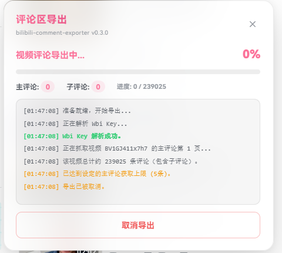
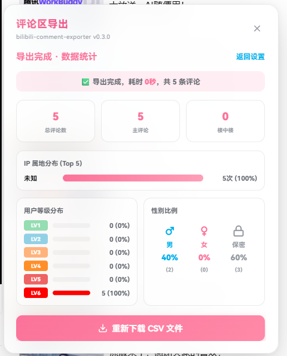

# Bilibili Comment Exporter

用于导出哔哩哔哩（Bilibili）视频评论区的浏览器用户脚本。在视频播放页或 UP 主空间页点击「导出评论」，即可抓取一级评论与楼中楼回复并保存为 CSV 文件。

[](https://github.com/Noctyn/bilibili-comment-exporter) [](https://github.com/Noctyn/bilibili-comment-exporter) [](https://github.com/Noctyn/bilibili-comment-exporter) [](https://github.com/Noctyn/bilibili-comment-exporter/blob/main/LICENSE) [](https://github.com/Noctyn/bilibili-comment-exporter)
---

## 功能特性

- **完整评论抓取**：支持导出主评论与楼中楼（二级子评论），可选按热度或发布时间排序。
- **UP 主批量导出**：支持在 UP 主空间页按页批量抓取多部投稿评论，并合并为单个 CSV 文件。
- **页面内嵌交互**：操作入口直接集成于视频工具栏与空间页操作区；界面采用 B 站配色与视觉规范（`#FB7299` 主题色、细边框卡片、下划线标签页），自适应页面深浅色模式，并持久化保存上一次的导出配置。
- **内置 Wbi 签名**：自动获取 `img_key` 与 `sub_key` 计算接口签名，避免请求返回 `-403`。
- **兼容主流表格软件**：导出文件包含 UTF-8 BOM 头，使用 Excel 或 WPS 直接打开无中文乱码。
- **内置统计看板**：导出完成后自动统计并展示 IP 属地 Top 5、LV1–LV6 等级分布及性别比例。

---

## 界面预览

| 视频工具栏入口 | 空间页入口 |
| :---: | :---: |
|  |  |

| 控制面板 | 导出进度 | 数据看板 |
| :---: | :---: | :---: |
|  |  |  |

---

## 安装

请先在浏览器中安装用户脚本管理器：[Tampermonkey](https://www.tampermonkey.net/)（推荐）或 [Violentmonkey](https://violentmonkey.github.io/)。

随后通过以下任一渠道安装脚本：

- [Greasy Fork 安装地址](https://greasyfork.org/zh-CN/scripts/582735)
- [GitHub Raw 直链安装](https://raw.githubusercontent.com/Noctyn/bilibili-comment-exporter/main/bilibili_comment_exporter.user.js)

---

## 使用说明

### 单视频导出

1. 打开任意 B 站视频播放页（`https://www.bilibili.com/video/BV...`）。
2. 点击视频下方操作栏（点赞、投币、收藏、分享右侧）的「导出评论」按钮打开控制面板，当前视频的 BVID 将自动填入。
3. 配置导出参数：
   - **排序方式**：热度优先 / 时间优先
   - **抓取范围**：是否包含楼中楼回复
   - **数量上限**：主评论最大抓取条数（留空表示不限制）
   - **请求间隔**：默认 `500` ms（数据量较大时建议适当调高，以降低触发风控的概率）
4. 点击「开始导出」，面板将实时显示抓取进度与运行日志。
5. 抓取完成后自动下载 CSV 文件，并切换至数据统计视图。

### UP 主空间批量导出

1. 打开目标 UP 主的空间主页（`https://space.bilibili.com/...`）。
2. 点击昵称旁操作区的「导出评论」按钮，面板将切换至「UP主批量」标签页并自动填入 Mid。
3. 设置抓取的投稿页数（默认 `3` 页，每页 30 个视频）及其他过滤条件。
4. 点击「开始批量导出」，脚本将按顺序逐一抓取视频评论，完成后合并导出为单个 CSV 文件。

> **提示**：按住面板标题栏可拖拽调整位置，按 `Esc` 键关闭面板。排序方式、楼中楼开关及请求间隔等配置均保存在本地 `localStorage` 中，下次打开自动生效。

---

## 导出字段说明

导出的 CSV 字段结构与命令行工具 `blblcd` 保持一致：

| 字段名称 | 类型 | 说明 | 示例 |
| :--- | :--- | :--- | :--- |
| `bvid` | String | 视频 BV 号 | `BV1e7NRemEwv` |
| `upname` | String | 评论者用户名 | `用户A` |
| `sex` | String | 评论者性别 | `男` / `女` / `保密` |
| `content` | String | 评论正文内容 | `精彩的视频！` |
| `pictures` | String | 评论附带图片 URL（多张图片以 `;` 分隔） | `https://i0.hdslb.com/...` |
| `rpid` | Number | 当前评论 ID | `243795113873` |
| `oid` | Number | 视频 AVID（十进制数字） | `113976755094913` |
| `mid` | Number | 评论者 UID | `123456` |
| `parent` | Number | 父评论 ID（一级评论为 `0`，子评论为对应父评论 ID） | `0` |
| `fans_grade` | Number | 是否佩戴粉丝勋章（`0`：未佩戴，`1`：已佩戴）* | `1` |
| `ctime` | Number | 评论发布时间戳（秒） | `1718314584` |
| `like` | Number | 评论获赞数 | `256` |
| `level` | Number | 评论者当前等级（`0`–`6`） | `5` |
| `location` | String | 评论者 IP 属地（需登录状态） | `北京` |

*\*注：具体粉丝勋章等级位于原始接口返回数据的 `member.fans_detail.medal_level` 字段。*

---

## 开发与测试

脚本采用单文件、零外部依赖设计，无需编译构建。仓库中的 `package.json` 仅用于执行本地单元测试：

```bash
npm test          # 等价于 node --test "test/*.test.js"
```

测试全程离线运行。`test/harness.mjs` 会在加载阶段将脚本末尾的 `init()` 替换为内部函数导出，并注入最小化的 `document`、`localStorage` 与 `fetch` 桩对象，用于对签名计算、错误分类、并发控制及任务取消逻辑进行断言。若修改脚本尾部的入口结构，测试装载器将抛出异常。

```text
bilibili-comment-exporter/
├── assets/                             # 图标与文档截图资源
├── bilibili_comment_exporter.user.js   # 用户脚本核心源码
├── test/
│   ├── harness.mjs                     # 测试装载器（最小 DOM / fetch 桩）
│   ├── logic.test.js                   # 纯函数、限速、API 与抓取流程测试
│   └── ui.test.js                      # 面板构建、日志合批与端到端测试
├── package.json                        # 本地测试配置（脚本本身无需构建）
├── LICENSE                             # MIT 开源许可证
└── README.md                           # 项目说明文档
```

---

## 相关项目

本脚本的接口调用逻辑与 CSV 字段定义参考自 [WShihan](https://github.com/WShihan) 开发的跨平台命令行工具 [blblcd](https://github.com/WShihan/blblcd)（基于 Go 编写，底层接口文档参考 [bilibili-API-collect](https://github.com/SocialSisterYi/bilibili-API-collect)）。两者导出的 CSV 数据结构一致，可直接互通使用。

- `blblcd` 仓库：[GitHub](https://github.com/WShihan/blblcd) | [Codeberg](https://codeberg.org/wsh233/blblcd)

---

## 免责声明

1. 本项目仅供个人学习、研究与技术交流使用，请勿用于任何商业或非法用途。
2. 使用本工具时请遵守哔哩哔哩（Bilibili）用户协议及相关法律法规。因高频请求、滥用工具导致的账号异常或其他后果，由使用者自行承担。
